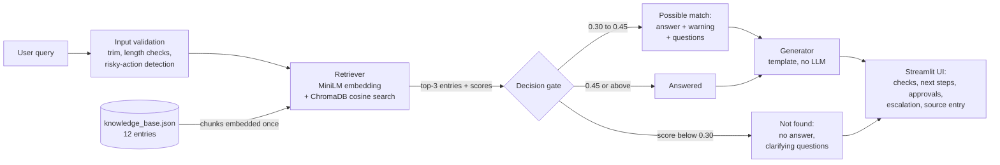

# AI Troubleshooting Assistant for L1/L2 Support

A prototype assistant that helps L1/L2 support engineers investigate common technical issues. The user describes a problem in plain language; the assistant finds the most relevant entry in a small knowledge base, shows step-by-step diagnostic checks, safe next steps and the likely escalation team, and **always shows the source entry** it used. If the knowledge base does not cover the issue, it says so and asks for more information instead of inventing a fix.

Built for *Practical AI Assignment 3: AI Troubleshooting Assistant for L1/L2 Support* (Technology Operations Intern).

> **Sample data only.** The knowledge base contains simulated scenarios written for this assignment. They are not real incidents or official runbooks of any company. Team names, thresholds and procedures are illustrative.

---

## Features

- **Plain-language chat interface** (Streamlit), with example queries in the sidebar.
- **Semantic retrieval** with a local embedding model and ChromaDB. It matches meaning, not just keywords ("customer charged but order unpaid" finds the *payment stuck / webhook* entry).
- **Grounded answers.** Every diagnostic check, next step and escalation rule shown is copied from the cited knowledge-base entry.
- **Source attribution.** Each answer shows the entry ID, title, similarity score, the exact text that matched, and the full raw entry.
- **Three confidence levels** instead of always answering:
  - **Answered:** confident match.
  - **Possible match:** shown with a warning and clarifying questions.
  - **Not found:** no resolution is suggested; the assistant asks for details.
- **Escalation guidance.** Each entry has one or more rules naming the team and the condition (for example, Database Team when connections are at the maximum limit).
- **Safety by design.** The assistant has no ability to execute anything. Disruptive actions (restart, rollback, deleting data) appear only under **"Requires approval"**, and questions that mention such actions get an explicit warning.
- **Error handling.** Empty or overly long input, retrieval failures and generator failures are all handled without crashing.
- **Honest labelling.** Every answer states how it was generated: `Knowledge-base template (no LLM)`.

## What "AI" means in this project (and what it does not)

| Part | Uses AI? | Details |
|---|---|---|
| Understanding the user's description and finding the right entry | **Yes** | `all-MiniLM-L6-v2` sentence-embedding model (a neural network), run locally |
| Writing the answer | **No (by design, for now)** | A transparent template builds the answer from the retrieved entry |

**Why there is no LLM for answer generation.** No paid LLM API was available for this project. Rather than present template output as if an LLM wrote it, the generator is an explicit, swappable component (`src/generator.py`) and the UI labels every answer with its generator. An LLM generator (for example a free local model through Ollama) can be added as one class without changing retrieval, decision logic or the UI. If that LLM fails, the assistant already falls back to the template; this fallback is tested.

The template approach is *more* grounded than an LLM (it cannot invent steps), but *less* flexible: it cannot rephrase or tailor steps to the user's specific details.

---

## Architecture



**Module responsibilities**

| Module | Responsibility |
|---|---|
| `src/kb_loader.py` | Load and **validate** the KB: required fields, ID format, unique IDs, allowed team names, valid cross-references. |
| `src/retriever.py` | Embed KB chunks, store them in ChromaDB, and return the top-k entries with similarity scores. It doesn't decide anything. |
| `src/assistant.py` | Input validation, risky-action warning, confidence decision, ambiguity flag, error handling, generator fallback. |
| `src/generator.py` | `AnswerGenerator` interface and the `TemplateGenerator` implementation. |
| `app.py` | Streamlit UI. It only displays responses; there is no business logic here. |

### Retrieval design

- **What gets embedded.** For each entry: the title, **each symptom separately**, and the keyword list. Users describe *symptoms* ("getting 500s"), not fixes, so resolution text is deliberately **not** embedded.
- **Scoring.** An entry's score is the cosine similarity of its **best-matching chunk**.
  - The first version embedded each entry as one long text. Calibration showed that an out-of-scope query ("Kafka consumer lag", 0.386) scored *higher* than a correct match (0.384), so no threshold could separate them.
  - Embedding chunks separately raised the lowest correct match to 0.483, while the highest out-of-scope score was 0.415. The two became separable. Details are under [Testing](#testing-and-evaluation).
- **Thresholds** (`.env`): `HIGH_CONFIDENCE_THRESHOLD=0.45`, `LOW_CONFIDENCE_THRESHOLD=0.30`. They were chosen from measured score distributions (`scripts/calibrate_retrieval.py`), not guessed.
- **Ambiguity.** If the second entry is also confident and within 0.05 of the top score, the user is asked which description fits better.
- **Index freshness.** A fingerprint of the KB chunks and model name is stored in ChromaDB. The index is rebuilt automatically when the KB changes and reused otherwise.

### Knowledge-base format

`data/knowledge_base.json`. One JSON object per issue, for example (shortened):

```json
{
  "id": "KB-003",
  "title": "Database connection failures or connection pool exhausted",
  "category": "Database",
  "symptoms": ["Errors such as 'connection pool exhausted', 'too many connections' ..."],
  "keywords": ["database", "connection pool", "jdbc", "hikaricp", "..."],
  "diagnostic_checks": ["Check the database monitoring dashboard ...", "..."],
  "resolution_steps": ["If the database is unreachable, escalate immediately to the Database Team ...", "..."],
  "requires_approval": ["Terminating database sessions or killing queries", "Restarting the database ..."],
  "escalation": [{"team": "Database Team", "when": "Database is unreachable, connections are at the maximum limit ..."}],
  "prerequisites": ["Read-only access to database monitoring dashboards"],
  "related_ids": ["KB-001", "KB-007"]
}
```

**The 12 sample entries:**

| Entry | Issue |
|---|---|
| KB-001 | Payment API HTTP 500 |
| KB-002 | API timeouts / 504 |
| KB-003 | Database connection or pool failures |
| KB-004 | Authentication 401/403 |
| KB-005 | High latency |
| KB-006 | Service unavailable / 503 |
| KB-007 | Network or DNS failure |
| KB-008 | TLS certificate expiry |
| KB-009 | Card decline spike |
| KB-010 | Settlement batch failure |
| KB-011 | Payment stuck pending / webhook missing |
| KB-012 | Disk full |

Escalation teams are limited to a fixed list (validated on load): L1 Operations / Command Center, L2 Application Support, Database Team, Network Team, DevOps / Infrastructure Team, Security / IAM Team, Payments Operations Team.

---

## Tech stack

| Component | Choice (version) | Why | Alternatives considered |
|---|---|---|---|
| Language | Python 3.12 | Main skill set; mature ML package support on Windows | — |
| UI | Streamlit 1.66.1 | Chat UI in one file, no front-end build | React + Express (too slow to build for the deadline) |
| Embeddings | sentence-transformers 5.7.0, `all-MiniLM-L6-v2` | Free, local, no API key, deterministic; ~90 MB | OpenAI / Mistral embedding APIs (need a paid key and network) |
| Vector store | ChromaDB 1.5.9 (persistent, cosine) | Simple local vector DB; easy to scale or swap later | NumPy in memory (enough for 12 entries), FAISS |
| Orchestration | Plain Python, no LangChain | The pipeline is four steps; plain code keeps every step visible and explainable | LangChain (useful for larger pipelines) |
| Config | python-dotenv 1.2.4 | Settings in `.env`, never in code | — |
| Tests | pytest 9.1.1, Streamlit `AppTest` | Unit, retrieval, decision-logic and headless UI tests | — |

No paid service is used. Running the project costs nothing.

---

## Setup (Windows PowerShell)

Requirements: Windows 10/11, the Python Install Manager (`py`), about 1.5 GB of disk space (mostly PyTorch), and internet access on the first run.

```powershell
# 1. Install Python 3.12 (skip if already installed)
py install 3.12

# 2. Create and activate a virtual environment in the project folder
py -V:3.12 -m venv .venv
.\.venv\Scripts\Activate.ps1

# 3. Install dependencies (5–15 minutes; PyTorch is large)
python -m pip install --upgrade pip
pip install -r requirements.txt

# 4. Create local config (no API key needed)
Copy-Item .env.example .env

# 5. Optional: verify the environment (downloads the embedding model on first run)
python scripts\check_setup.py

# 6. Run the app (opens http://localhost:8501)
python -m streamlit run app.py
```

**Notes**
- Use `python -m streamlit run app.py`, not `streamlit run app.py`. On machines with **Windows Smart App Control** enabled, the unsigned `streamlit.exe` launcher and some compiled package files can be blocked (`An Application Control policy has blocked this file`). Running through the venv's signed `python.exe` avoids the launcher block. The app also avoids `st.table`, which loads pandas DLLs that were blocked on the development machine.
- The app binds to `localhost` only (`.streamlit/config.toml`), so it isn't exposed on the network.
- The first query after startup takes a few seconds while the model loads. Later queries are fast.
- The message "You are sending unauthenticated requests to the HF Hub" is harmless; no token is needed.

### Configuration (`.env`)

| Variable | Default | Meaning |
|---|---|---|
| `EMBEDDING_MODEL` | `sentence-transformers/all-MiniLM-L6-v2` | Local embedding model |
| `GENERATOR` | `template` | Answer generator (only `template` is implemented) |
| `TOP_K` | `3` | Entries retrieved per query |
| `HIGH_CONFIDENCE_THRESHOLD` | `0.45` | At or above this: confident answer |
| `LOW_CONFIDENCE_THRESHOLD` | `0.30` | Below this: not found |

Command-line check without the UI:

```powershell
python -m src.assistant "The payment API is returning a 500 error"
```

---

## Project structure

```
├── app.py                         Streamlit UI
├── src/
│   ├── config.py                  Settings from .env
│   ├── kb_loader.py               KB loading + validation
│   ├── retriever.py               Embeddings + ChromaDB search
│   ├── assistant.py               Decision logic, error handling, CLI
│   └── generator.py               Generator interface + template generator
├── data/knowledge_base.json       12 sample KB entries
├── scripts/
│   ├── check_setup.py             Environment check
│   ├── calibration_queries.json   33 labelled queries for threshold calibration
│   └── calibrate_retrieval.py     Calibration script
├── tests/
│   ├── test_kb_loader.py          8 tests
│   ├── test_retrieval.py          9 tests
│   ├── test_assistant.py          12 tests (fake retriever, deterministic)
│   ├── test_app.py                4 headless UI tests
│   ├── eval_cases.json            33 held-out evaluation cases
│   └── run_eval.py                End-to-end evaluation script
├── results/                       Calibration and evaluation outputs (CSV + Markdown)
├── docs/                          Presentation plan and interview preparation
├── CONTRIBUTION.md                Individual contribution and AI-tool usage
├── requirements.txt  .env.example  .gitignore  .streamlit/config.toml
```

---

## Testing and evaluation

```powershell
python -m pytest -q                               # 33 automated tests
python -m scripts.calibrate_retrieval             # threshold calibration (writes results/retrieval_calibration.csv)
python -m tests.run_eval --tag my_run             # held-out evaluation (writes tagged files in results/)
```

### 1. Automated tests: 33 passing
- **Loader:** valid KB; missing file, broken JSON, duplicate IDs, missing fields, unknown team and broken cross-references are all rejected.
- **Retrieval:** the assignment's example query finds KB-001; paraphrases match; off-topic queries score below the low threshold; plus the regression tests described below.
- **Decision logic:** every status path, the ambiguity flag, retrieval failure, generator failure with template fallback, and the risky-action warning.
- **UI** (Streamlit `AppTest`, headless): the app starts; a known issue shows its answer, source and "no LLM" label; an unknown issue shows no answer and no source; example buttons work.

### 2. Threshold calibration: 33 labelled queries
25 in-KB (known and paraphrased) plus 8 out-of-KB (off-topic and near-domain). Results are in `results/retrieval_calibration.csv`.

| Retrieval method | Top-1 accuracy | Lowest correct match | Highest out-of-KB score | Separable? |
|---|---|---|---|---|
| One embedding per entry | 25/25 | 0.384 | 0.386 | No |
| One embedding per chunk (final) | 25/25 | 0.483 | 0.415 | Yes |

The calibration CSV was recorded before the KB-003 keyword change described below.

### 3. Held-out evaluation: 33 new cases
These queries were not used for calibration, and their expected behaviour was written before the first run. Each case is checked automatically:
- status
- correct source entry
- no confident answer for out-of-KB issues
- citation matches the displayed source
- every step exists word for word in the cited entry (grounding)
- risky-action warning
- failure handling

Categories: known issues, paraphrases (including one Hinglish query), ambiguous, vague, near-domain unsupported, off-topic, a prompt-injection attempt, risky actions, invalid input, simulated LLM failure and simulated vector-store failure.

| | Baseline (`results/eval_summary.md`) | After E04 fix (`results/eval_summary_after_e04_fix.md`) |
|---|---|---|
| **Overall** | **31/33** | **32/33** |
| Retrieval top-1 on in-KB queries | 14/15 | 15/15 |
| Out-of-KB / vague queries not answered confidently | 9/9 | 9/9 |
| Confident answers to out-of-KB queries | 0 | 0 |
| Grounding or attribution violations | 0 | 0 |

**Failures and what was done:**
- **E04, fixed.** "HikariCP says connection is not available, request timed out…" retrieved the *timeout* entry instead of the *database connection pool* entry; the small model doesn't know HikariCP jargon.
  - Fix: added `hikaricp` and `connection is not available` to KB-003's keywords. No threshold was changed.
  - Regression tests were added, including a real HikariCP log line that isn't in any evaluation set, plus a guard that generic timeouts still map to KB-002.
  - Only E04 changed between the two runs. Because the fix was made after seeing this result, **E04 no longer counts as held-out**; 31/33 is the clean baseline figure.
- **E25, open.** "Write me a poem about servers" scored 0.307 (just above the 0.30 floor) and was shown as a *possible match* with a warning, instead of *not found*. It was not answered confidently. Kept as a documented limitation.

These are small, self-written test sets. The results show the design behaves as intended; they are not production accuracy figures.

---

## Assumptions

- Users are L1/L2 engineers who will verify suggestions before acting. The assistant supports decisions; it doesn't make them.
- Queries are in English or English-heavy Hinglish (technical terms in English).
- The knowledge base is small, curated and trusted. Its quality limits answer quality.
- Team names, thresholds (such as "5xx above 2% for 5 minutes") and procedures are illustrative.
- Each query is handled independently (no multi-turn memory); clarification works by the user sending a more detailed query.

## Limitations

- **No LLM-generated wording.** Answers are copied from the KB, so they can't adapt to specific details such as a particular merchant or error text.
- **Low-confidence matches can show loosely related steps.** For "Kafka consumer lag" the closest entry is *High API latency*, shown with a "possible match only" warning. The right fix is a KB entry for queue lag.
- **Small KB (12 entries) and small test sets (33 + 33 queries).** Thresholds may need re-calibration as the KB grows or the model changes.
- **Domain jargon** not present in the KB can be missed (as E04 showed). Keyword enrichment from real incident data is needed.
- **Ambiguity detection** only compares scores. "Payments are failing" is answered from KB-001 without asking whether the user means 500s, declines or stuck payments.
- **Risky-action detection is a keyword pattern.** "Bounce the DB" is not caught.
- **Not production-ready:** no authentication, audit logging, rate limiting or monitoring of the assistant itself.
- **English embedding model:** non-English queries work only when the technical terms are in English.

## Security considerations

- No secrets are needed. `.env` is git-ignored, and `.env.example` documents settings without values.
- The app listens on `localhost` only.
- The assistant cannot execute commands or connect to any system; it only displays KB text.
- No LLM means no prompt-injection path. The injection test (E26) returns *not found*.
- KB guidance tells engineers never to paste card numbers (PAN) or credentials into tickets or chat.

## Possible future improvements

1. **Optional LLM generator** (a free local model via Ollama, or a hosted API), with the prompt restricted to retrieved entries, output that must cite entry IDs, and automatic citation checks. The template fallback already exists.
2. **Hybrid retrieval** (BM25 keywords plus embeddings) or a cross-encoder re-ranker to handle jargon such as E04.
3. **Multi-turn clarification** for ambiguous queries such as "payments are failing".
4. **Grow the KB from real incident tickets and post-incident reviews**, plus a feedback button ("this helped / didn't help") to find gaps.
5. **Read-only integrations** (log search, monitoring dashboards, ticketing system) to pre-fill context, still without executing changes.
6. **Authentication, audit logging, and a review workflow** for KB changes.

---

## AI tools used in development

Claude Code (Anthropic, model Claude Opus 5.5) was used as an AI pair programmer. See [CONTRIBUTION.md](CONTRIBUTION.md) for what I did and what the AI tool did.
